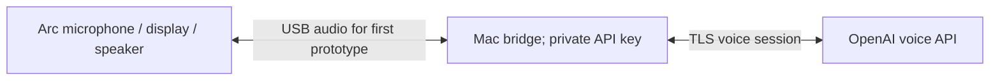

# Deferred OpenAI path

**Status: deferred at the owner's explicit request.** The owner wants to experience Muse for 3–5 days before integrating OpenAI. No reminder was requested or created. Current working firmware is Muse live voice.

What happened: we consulted official OpenAI voice/WebSocket documentation, proposed a Mac-hosted bridge with credentials on the Mac, downloaded the official hardware example reference, created a minimal local directory/configuration scaffold and installed isolated Python packages. No key was provided. **No OpenAI API request, working bridge implementation, OpenAI firmware build or deployment occurred.** The scaffold is preserved privately as unfinished material, not presented as a usable product.

## Intended first milestone

1. Verify microphone capture, transport to the Mac, cloud voice response and playback on Arc.
2. Keep keys and network credentials out of firmware and Git. Use owner-controlled local secrets.
3. Start with push-to-talk and explicit call/session lifecycle; cap audio queues and handle cancellation.
4. Add wireless transport after speech is demonstrated. Check eero guest isolation before assuming a main-network Mac is reachable.
5. Add conversation memory, persona and tools as separate tested features.
6. Consider an always-on host later; a Mac bridge initially needs the Mac awake.

Adding OpenAI TTS to read Muse answers is a smaller, different integration from replacing Muse as the assistant. The owner selected the fuller path, then deferred it. Do not resume implementation or overwrite working Muse without the owner's new instruction and explicit flash confirmation.

## Documentation consulted

- [OpenAI Realtime overview](https://developers.openai.com/api/docs/guides/realtime)
- [Voice WebSocket transport](https://developers.openai.com/api/docs/guides/voice-websockets)
- [Realtime conversations / push-to-talk](https://developers.openai.com/api/docs/guides/realtime-conversations)
- [API authentication overview](https://developers.openai.com/api/reference/overview)

At research time examples included `gpt-realtime-2.1`, 24 kHz mono PCM and manual turn detection/commit events. These are **research notes**, not a shipped model/configuration. Recheck current documentation, availability, account access and pricing before implementing; no API billing entitlement was verified.
